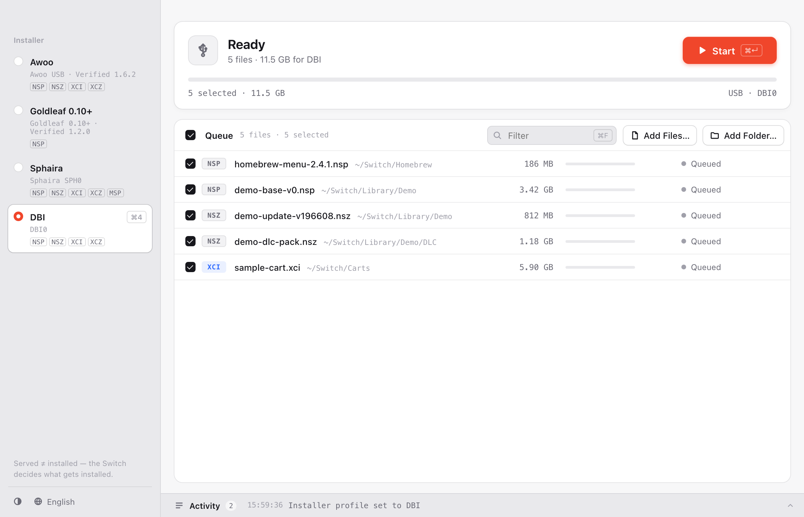
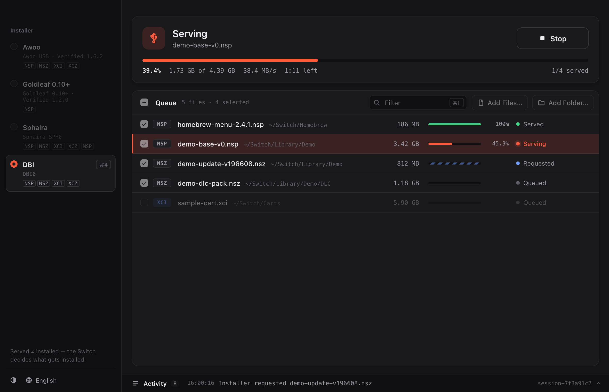

  
   
  <strong style="font-size: 32px">NSP Carrier</strong>

简体中文 · [English](README.md)

**NSP Carrier** 是一款桌面应用，通过 USB 把游戏文件传给 Switch 上的安装器。支持 Awoo、Goldleaf、Sphaira 和 DBI，可在 macOS 和 Windows 上运行。

它只负责送文件：安装由 Switch 上的安装器完成，NSP Carrier 从不写入 Switch。已送达不等于已安装。

## 使用

1. 在 Switch 上打开安装器，进入 USB 模式。
2. 用 USB 线把 Switch 连到电脑。
3. 在 NSP Carrier 里选择与安装器对应的 profile。
4. 把文件或文件夹加入队列。支持拖放，文件夹会递归扫描。
5. 点击 **开始**，然后在 Switch 上确认安装。

安装器读取文件时，应用会显示每个文件的进度。界面支持 English 和简体中文，以及浅色、深色主题，都可以在侧边栏底部切换。

## 支持的安装器

| Profile | 格式 | 真机验证版本 |
| --- | --- | --- |
| [Awoo](https://github.com/Huntereb/Awoo-Installer) | `.nsp` `.nsz` `.xci` `.xcz` | 1.6.2 |
| [Goldleaf](https://github.com/XorTroll/Goldleaf) 0.10+ | `.nsp` | 1.2.0 |
| [Sphaira](https://github.com/NaGaa95/sphaira) 1.0+ | `.nsp` `.nsz` `.xci` `.xcz` `.msp` | —（兼容，尚未真机验证） |
| DBI | `.nsp` `.nsz` `.xci` `.xcz` | — |

- 队列里有当前 profile 不支持的文件时，**开始** 会被禁用，并指出是哪个文件。不会悄悄跳过。
- Sphaira 0.13.3 及更早版本使用旧的不兼容协议，不受支持。

## 安装

从 [Releases](https://github.com/timonwong/nsp-carrier/releases) 下载最新版本：

| 平台 | 文件 | 说明 |
| --- | --- | --- |
| macOS（Apple Silicon） | `nsp-carrier-macos-arm64.zip` | 解压后把 `NSP Carrier.app` 拖进“应用程序”。已内置 `libusb`。 |
| Windows（x64） | `nsp-carrier-windows-amd64.zip` | 解压后运行 `nsp-carrier.exe`。可能需要装 USB 驱动（见下文）。 |

安装包没有代码签名，也没有经过公证。

### macOS：首次打开

第一次打开时 macOS 会拦截。先打开一次，再到 **系统设置 → 隐私与安全性** 点击 **仍要打开**。较旧的 macOS 可以直接右键应用选择 **打开**。

### Windows：USB 驱动

Windows 10 及以上通常会自动绑定可用的 WinUSB 驱动，先直接试试 NSP Carrier。如果识别不到 Switch，再用 [Zadig](https://zadig.akeo.ie/) 装驱动：

1. 连接 Switch，让安装器进入 USB 模式（DBI：DBIbackend · Awoo：USB install · Goldleaf：Remote PC · Sphaira：USB install）。
2. 运行 Zadig，勾选 **Options → List All Devices**。
3. 选中 Switch。厂商 ID 是 `057E`（Nintendo），名称通常显示为 `DBI`、`USB composite device` 或 `057E:3000`。
4. 驱动选 **libusbK**（没有的话选 **WinUSB**），点击 **Replace Driver** 或 **Install Driver**。
5. 启动 NSP Carrier，确认能识别到设备。

## 应用报告什么

- **已送达** 表示安装器已读完当前 profile 要求的全部字节，不代表 title 已安装。
- 拔线或安装器重启后，下次连接会开始新的会话，不会续传。
- Linux 版本只在 CI 中编译，没有发布，也没有经过真机测试。

## 从源码构建

构建步骤、开发者 USB CLI 和协议说明见 [DEVELOP.md](DEVELOP.md)。

## 许可

[MIT](LICENSE)。

## 致谢

各 USB 协议依据实际观测到的通信行为实现，参考了以下项目：

- [`rashevskyv/dbibackend-qt`](https://github.com/rashevskyv/dbibackend-qt) —— DBI 后端
- [`developersu/ns-usbloader`](https://github.com/developersu/ns-usbloader) —— Awoo 与 Goldleaf 通信格式
- [`Huntereb/Awoo-Installer`](https://github.com/Huntereb/Awoo-Installer) —— Awoo
- [`XorTroll/Goldleaf`](https://github.com/XorTroll/Goldleaf) —— Goldleaf
- [`NaGaa95/sphaira`](https://github.com/NaGaa95/sphaira/tree/3f8303db00f33bfffa83ce0a1b750a1de14656e2) —— Sphaira 1.0.6，固定 revision
